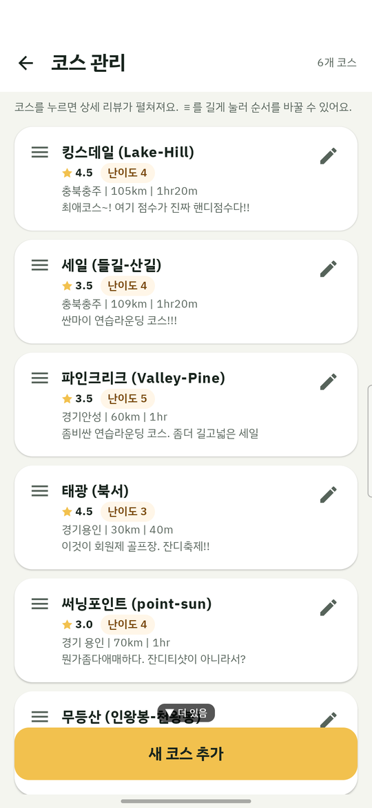
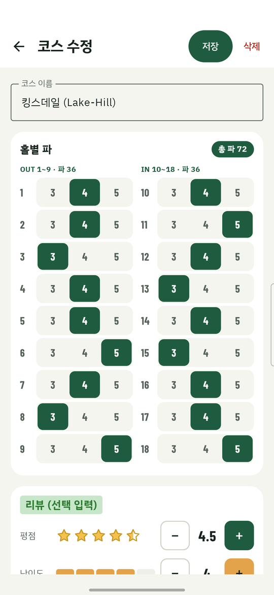
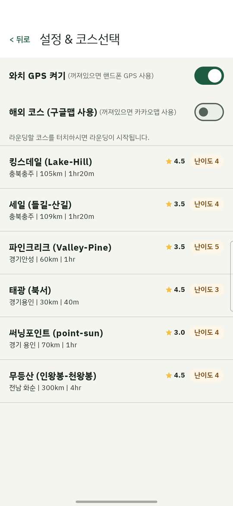
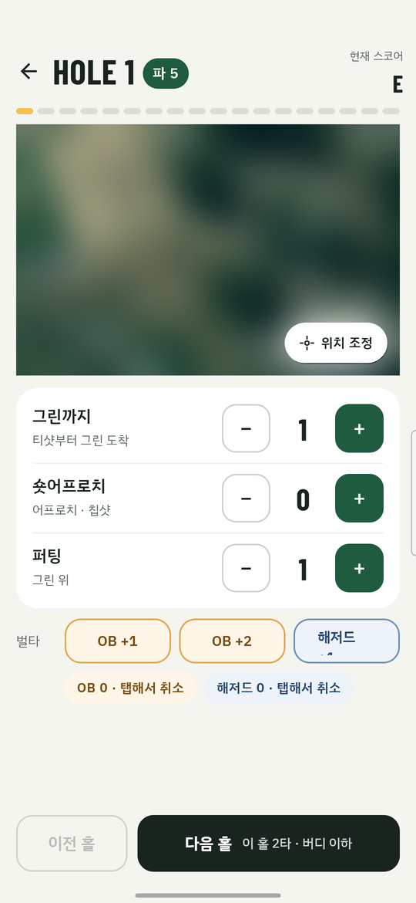
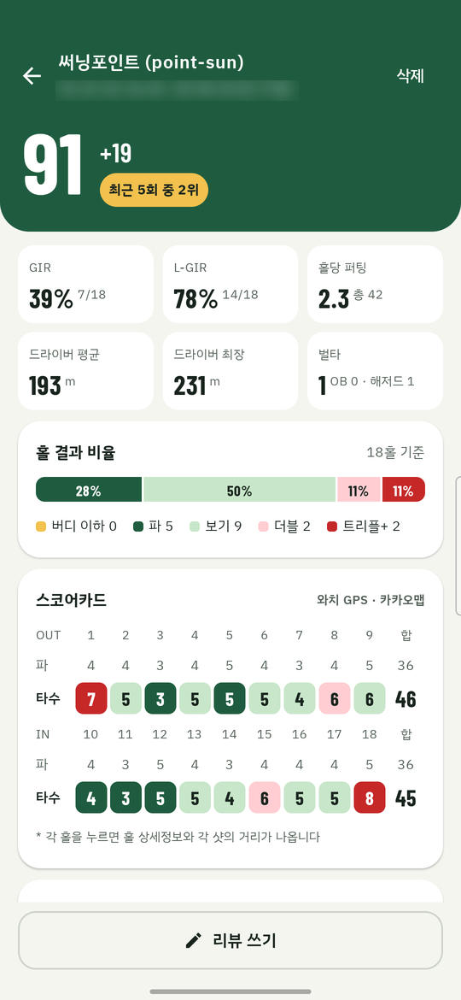
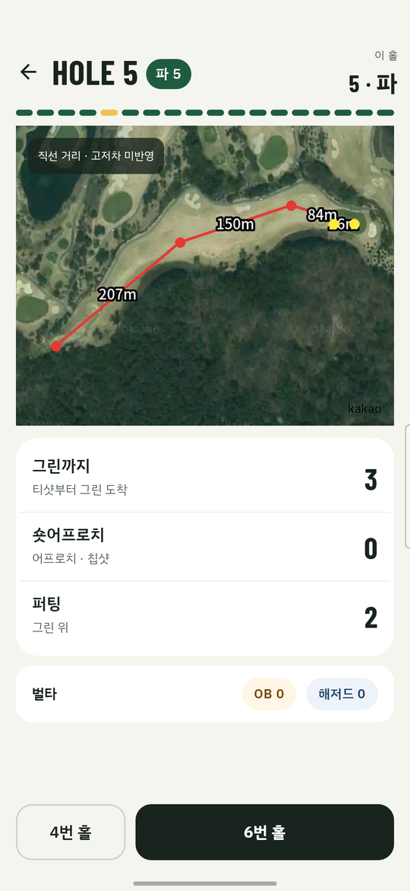
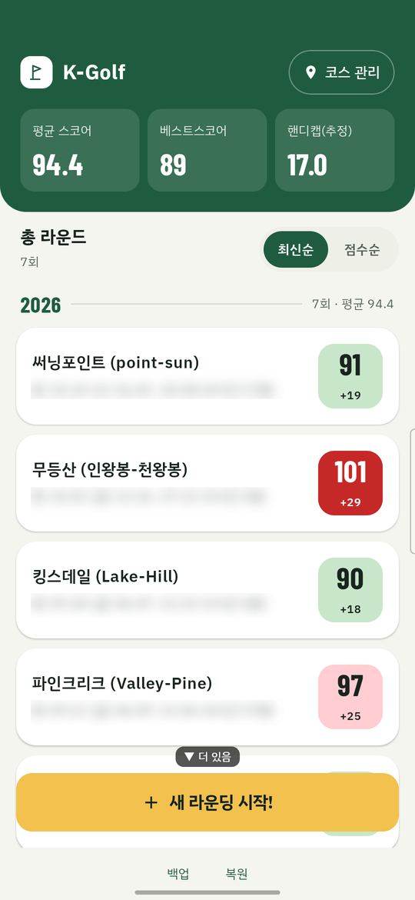
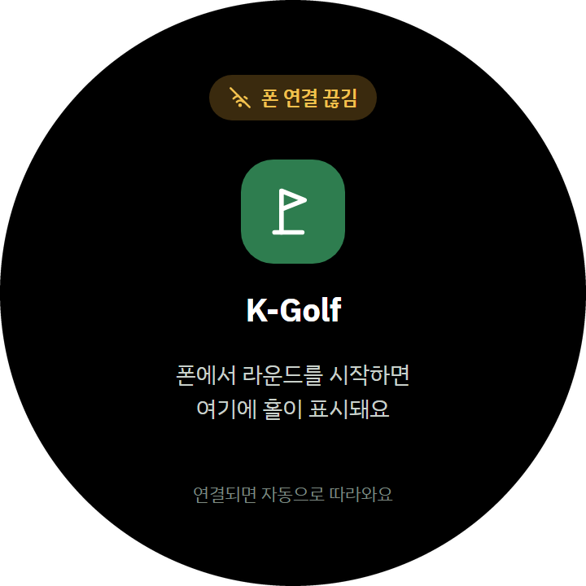
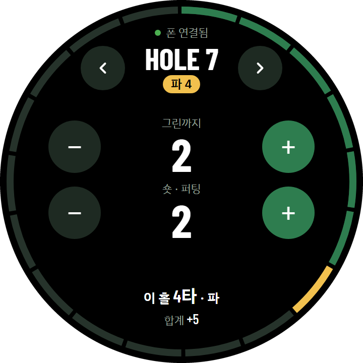
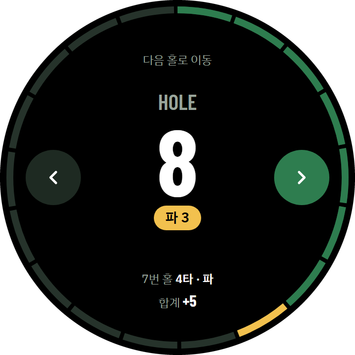

# K-Golf 사용 설명서

처음 켜는 분을 위한 5분 가이드 — 코스 등록부터 라운드 결과 확인까지. *(v0.11 · UX 2.0 기준)*

이 앱은 라운드마다 홀별 타수, 벌타, 샷 위치를 기록하고 끝나면 스코어를 정리해서 보여주는 골프 기록 앱이에요. 아래 순서 그대로 따라 하면 5분 안에 첫 라운드를 시작할 수 있어요.

## 이 앱이 다른 앱과 다른 점

| | |
|---|---|
| **지도를 내려받을 필요가 없어요** | 카카오맵·구글맵 위성지도를 그대로 쓰기 때문에 골프장 지도 데이터를 따로 받거나 업데이트할 일이 없고, 지도가 실제 코스와 어긋날 일도 없어요. 지도는 인터넷으로 불러와요 — 통신이 약한 곳에서는 지도 배경만 빠지고 타수·위치 기록은 그대로 돼요. |
| **친 자리에서 그대로 기록돼요** | 타수를 올리는 순간의 GPS 위치가 샷으로 남아서, 실제로 어떻게 라운딩했는지 이동 경로와 샷 사이 거리(m)가 정확히 기록돼요. 거리는 직선 거리라 고저차(오르막·내리막)는 반영되지 않아요. |
| **알아둘 점 — 타수를 임의로 조정할 수 없어요** | 숫자만 따로 고치는 기능이 없어요. 기록이 실제 샷과 항상 같게 남는 대신, 잘못 눌렀다면 라운딩 중에 **−**로 마지막 샷을 지우고 다시 기록해야 해요. 끝난 라운드의 타수는 수정할 수 없어요. |

## 0. 설치하기

1. [릴리즈 페이지](https://github.com/dayfly2u/k-golf/releases/latest)의 **Assets**에서 `app-debug.apk` 파일을 폰에 다운로드해요.
2. 파일을 눌렀을 때 "출처를 알 수 없는 앱" 경고가 뜨면 **설치 허용**을 눌러요 (앱스토어를 거치지 않고 직접 설치하는 파일이라 뜨는 정상적인 경고예요).
3. 설치가 끝나면 **K-Golf** 아이콘을 눌러 실행해요. 위치 권한은 **"앱 사용 중에만 허용"**으로 해주세요 (샷 위치를 기록하는 핵심 기능이에요).

> **TIP** 이전 버전 위에 그대로 덮어 설치하면 코스와 라운드 기록이 그대로 유지돼요. 예전 버전(UX 1.0)에 기록이 있다면 설치 전에 아래 안내대로 백업부터 해두세요.

### 0-1. 이전 버전(UX 1.0)을 쓰고 있다면 — 기록 그대로 가져오기

예전 K-Golf(v0.7.x 등 UX 1.0 화면)에 기록을 쌓아 두셨다면, 새 버전으로 바꾸기 전에 **백업 파일**을 하나 만들어 두세요. 코스(홀별 파·평점·리뷰·유튜브 링크 포함), 라운드, 샷 위치, 벌타가 파일 하나에 통째로 들어가요.

1. **예전 버전에서 백업** — 홈 화면 맨 아래 **"백업"**을 눌러요. 파일을 저장할 위치(예: 내 파일의 `Download` 폴더, 구글 드라이브)를 고르고 저장하면 **"백업 완료"**가 떠요. 파일 이름은 `golf_recorder_backup_날짜_시간.db` 모양이에요.
2. **새 버전 설치** — 위 0번처럼 새 `app-debug.apk`를 설치해요. 예전 앱 위에 그대로 덮어 설치하면 기록이 이어지는 게 보통이지만, 만약을 위해 1번 백업은 꼭 먼저 해두세요.
3. **새 버전에서 복원** — 새 버전 홈 화면 맨 아래 **"복원"** → 방금 저장한 백업 파일 선택 → **"백업을 복원할까요?"** 창에서 **"복원"**을 눌러요. 앱이 저절로 다시 켜지면서 예전 기록이 나타나요. 홈의 **총 라운드** 수와 **코스 관리**의 코스 목록이 예전과 같은지 확인해 보세요.

> **주의**
> - **복원은 "덮어쓰기"예요.** 지금 기기에 있는 코스·라운드 기록이 전부 백업 파일 내용으로 바뀌고 되돌릴 수 없어요. 새 버전에서 새 라운드를 기록하기 **전에** 먼저 복원하세요.
> - **앱을 삭제하고 다시 설치하거나 폰을 바꾸는 경우**엔 삭제하는 순간 폰 안의 기록이 모두 사라져요. 백업 파일이 폰 밖(구글 드라이브, PC, 메신저의 "나에게 보내기" 등)에도 있는지 확인한 뒤에 삭제하세요. 새 폰으로 옮길 때는 그 파일을 새 폰으로 받아서 위 3번대로 복원하면 돼요.
> - **백업/복원 메뉴는 v0.4.0 이후 버전부터 있어요.** v0.3.0 이하(첫 릴리즈 v0.2.0 포함)의 아주 오래된 버전에는 백업 메뉴가 없어서 이 방법으로 옮길 수 없어요.

## 1. 자주 가는 코스 등록하기

맨 처음엔 등록된 코스가 없어요. 홈 화면 오른쪽 위 **"코스 관리"**를 눌러 맨 아래 **"새 코스 추가"**로 들어가면 코스를 만들 수 있어요.

- **코스 이름**을 적고, **홀별 파**에서 18홀 각각의 파(3·4·5)를 눌러 정해요. 왼쪽이 전반(OUT 1~9), 오른쪽이 후반(IN 10~18)이고 맨 위에 **총 파**가 바로 계산돼요.
- 그 아래 **리뷰 (선택 입력)** 에서 **평점**(별, −/+)과 **난이도**, 지역·거리·시간, 한줄평, 교통·클럽하우스·코스에 대한 메모를 남길 수 있어요. 안 적어도 라운드엔 지장 없어요.
- 코스를 한 번 저장하면 **유튜브 링크**도 붙일 수 있어요. 영상을 검색해서 고르거나 주소를 직접 붙여 넣어요.

한 번 등록해두면 다음부터는 라운드 시작할 때 목록에서 고르기만 하면 돼요.

> **TIP** 코스 관리 목록에서 코스 카드를 누르면 상세 리뷰가 펼쳐지고, 손잡이(≡)를 꾹 눌러 드래그하면 순서를 바꿀 수 있어요. 오른쪽 연필 아이콘이 수정이에요.

| 코스 관리 — 등록된 코스 목록 | 코스 수정 — 홀마다 파, 평점·난이도 |
|---|---|
|  |  |

## 2. 라운드 시작하기

홈 화면 아래쪽 노란 **"새 라운딩 시작!"** 버튼을 누르면 **"설정 & 코스선택"** 화면이 열려요. 맨 위에 스위치 두 개가 있고, 대부분은 그냥 끈 채로 시작하면 돼요. 아래 상황에서만 켜주세요.

- **와치 GPS 켜기** — 라운드 중 폰을 카트에 두고 다닐 때. 워치가 대신 위치를 기록해줘요. (꺼져 있으면 폰 GPS를 써요.)
- **해외 코스 (구글맵 사용)** — 국내가 아닌 해외 코스일 때. 카카오맵은 국내만 지원해서, 해외에서는 이 스위치를 켜야 지도가 나와요.

코스 목록에는 각 코스의 **평점(별)과 난이도, 지역 | 거리 | 소요시간**이 같이 보여서 고르기 쉬워요. 코스를 누르면 바로 1홀부터 라운드가 시작돼요. (알림 권한을 물어보면 허용해주세요 — 라운드 중 워치 연동과 워치 배터리 경고에 쓰여요.)

## 3. 홀마다 타수 입력하기

**홀 기록** 화면이에요. 위쪽에 **HOLE 번호와 파**, 그 아래 18칸 **진행바**(지나온 홀은 초록, 지금 홀은 노랑)가 있고, 오른쪽 위에는 지금까지의 **현재 스코어**(파 대비)가 떠요.

위성 지도 아래 카드에서 **그린까지 · 숏어프로치 · 퍼팅**을 −/+로 그때그때 기록해요. 버튼을 누른 순간의 GPS 위치가 지도 위에 점으로 남아요.

- 🔴 빨간 점 — 그린까지 친 샷
- 🔵 파란 점 — 숏어프로치
- 🟡 노란 점 — 퍼팅

**벌타**는 한 줄 버튼으로 기록해요 — **OB +1**, **OB +2**(특설티), **해저드 +1**. 잘못 눌렀으면 아래 **"OB 0 · 탭해서 취소"** 칩을 눌러 한 개씩 되돌려요.

지도가 내 위치와 다르게 보이면 지도 오른쪽 아래 **"위치 조정"**을 눌러 다시 맞출 수 있어요. 한 홀이 끝나면 아래 **"다음 홀"** 버튼으로 넘어가요 — 버튼에 "이 홀 2타 · 버디 이하"처럼 방금 홀의 타수와 결과가 같이 보여서 한 번 더 확인할 수 있어요. 앞 홀로 돌아갈 때는 **"이전 홀"**을 눌러요.

*(위 화면의 지도는 지금 있는 곳의 동네가 그대로 나와서 흐리게 처리했어요. 실제로는 코스 위성지도가 보여요.)*

## 4. 결과 확인하고 리뷰 남기기

홀 기록 화면 왼쪽 위 **← 뒤로**를 누르면 언제든 지금까지의 **결과 화면**으로 이동해요. 라운드 도중에도, 다 끝낸 뒤에도 같은 곳에서 볼 수 있어요 — 홀을 다 안 돌아도 기록은 사라지지 않아요.

- **맨 위 초록 영역** — 총타수와 파 대비 점수. 최근 라운드와 비교한 **"최근 5회 중 N위"** 배지도 떠요.
- **통계 카드** — **GIR**(파−2타 이내로 그린에 올리고 숏어프로치 없이 마친 홀 비율), **L-GIR**(숏어프로치가 있었어도 파−2타 이내로 그린에 올린 홀 비율), **홀당 퍼팅**(작게 총 퍼팅 수), **드라이버 평균·최장** 거리, **벌타**(OB·해저드).
- **홀 결과 비율** — 버디 이하 · 파 · 보기 · 더블 · 트리플+가 18홀 중 얼마나 되는지 한 줄 막대로 보여줘요.
- **스코어카드** — 전반(OUT)과 후반(IN)의 홀별 파와 타수. 칸 색으로 홀 결과를 한눈에 구분해요: 금색 = 버디 이하, 진한 초록 = 파, 연한 초록 = 보기, 연한 분홍 = 더블, 빨강 = 트리플 이상. 카드 오른쪽 위의 **"와치 GPS · 카카오맵"**은 이 라운드를 시작할 때 고른 위치·지도 설정이에요.

화면 아래 **"리뷰 쓰기"**를 누르면 **라운딩 가격·동반자·후기**를 남길 수 있어요 (모두 선택). 오른쪽 위 **"삭제"**는 이 라운드를 지울 때 써요.

스코어카드의 **타수 칸을 누르면 그 홀의 상세 화면**이 열려요. 그 홀에서 친 샷들이 지도 위에 선으로 이어지고, **샷과 샷 사이 실제 거리(m)**가 같이 표시돼요. 아래 카드에는 그 홀의 그린까지·숏어프로치·퍼팅 타수와 벌타가 있고, 맨 아래 버튼으로 앞뒤 홀로 이동해요.

> **TIP** 이 거리는 GPS 좌표 사이의 직선 거리라, 고저차(오르막·내리막)는 반영되지 않아요 — 실제 체감 거리와는 조금 다를 수 있어요.

## 5. 홈 화면에서 지난 기록 보기

*(위 화면은 실제 기록 예시라 날짜·시간 줄은 알아보기 어렵게 흐리게 처리했어요.)*

- **요약 타일 3개** — **평균 스코어**와 **베스트스코어**는 끝난 **18홀 라운드**만으로 계산해요 (9홀이나 중간에 나온 라운드는 빠져요). **핸디캡(추정)**은 끝난 18홀 라운드가 3개 이상 쌓이면 나타나고, 그전에는 "-"로 보여요. 월드 핸디캡 시스템 방식을 따르되 코스 레이팅을 파로 가정한 **추정값**이라 공식 핸디캡과는 다를 수 있어요.
- **총 라운드** 목록 — 완료한 라운드가 **연도별**로 묶여 쌓여요. 연도마다 **"2026 ──── 7회 · 평균 94.4"**처럼 구분선이 있어서 그 해 라운드 수와 평균을 바로 볼 수 있어요. 목록 제목 오른쪽의 **최신순 / 점수순**으로 정렬을 바꿔요 (점수순은 각 연도 안에서 타수가 적은 순서예요).
- **점수 배지** — 카드 오른쪽 배지에 총타수와 파 대비가 떠요. 색으로 점수대를 구분해요: 82타 미만 금색 · 82~89 진한 초록 · 90~94 연한 초록 · 95~99 연한 분홍 · 100타 이상 빨강.
- **연도 필터** — 기록이 **2개 연도 이상** 쌓이면 요약 타일 위에 **전체 · 2026 · 2025 …** 칩이 생겨요. 기본은 **전체**이고, 연도를 누르면 그 해 라운드만 보이며 평균 스코어·베스트스코어도 그 해 기준으로 바뀌어요 (핸디캡은 연도와 상관없이 최근 기록 기준 그대로예요).
- **카드를 누르면 펼쳐져요** — 그린피·동반자, 통계 4칸(GIR · 퍼팅 · 드라이버 · 벌타), 후기가 보이고, 맨 아래 **"상세 결과 보기 ›"**로 위 4번의 결과 화면을 열어요.

화면 맨 아래 **백업 / 복원**으로 전체 기록을 파일 하나로 저장해두는 것도 추천해요. (예전 버전에서 기록을 옮겨 오는 방법은 위 "0-1. 이전 버전(UX 1.0)을 쓰고 있다면"을 참고하세요.)

## 6. (선택) 갤럭시 워치 연동

폰만으로도 앱을 완전히 쓸 수 있어요 — 워치 연동은 라운드 중 폰을 꺼내지 않고 손목에서 타수를 올리고 싶을 때만 필요한 **선택 기능**이에요.

> **중요 — 워치로는 벌타를 기록할 수 없어요.** 워치에는 OB·해저드 벌타 버튼이 없어서, 벌타는 반드시 **폰**에서 입력해야 해요. 폰에서 입력한 벌타는 해당 줄 타수에 포함돼 워치 숫자에도 보이지만, 워치에서 벌타를 추가하거나 취소할 수는 없어요 (벌타가 마지막 기록이면 워치의 −도 먹지 않아요).

**준비물**
- Galaxy Watch (갤럭시 워치4 이후, Wear OS 3 이상) — 폰과 이미 페어링돼 있어야 해요 (갤럭시 웨어러블 앱으로 평소 하던 연결).
- 워치용 apk — 릴리즈 Assets의 `wear-debug.apk`.
- 폰 앱과 워치 앱은 **버전이 같아야** 해요 (이번 버전은 둘 다 0.11). 한쪽만 예전 버전이면 새 연동 기능이 일부만 동작해요.

**설치 방법** — 워치는 폰처럼 apk 파일을 눌러서 바로 설치할 수 없어서, 폰에 설치 도우미 앱을 하나 더 깔아야 해요.

1. 워치에서 **설정 → 워치 정보(또는 정보) → 소프트웨어**로 들어가서 **빌드 번호**를 5~7번 연속으로 탭해요 — "개발자 모드가 켜졌습니다" 안내가 뜨면 성공.
2. 워치 **설정 → 개발자 옵션**에서 **ADB 디버깅**을 켜요.
3. 폰의 Play 스토어에서 **"Wear Installer"**(워치 apk 설치를 도와주는 앱)를 설치해요.
4. Wear Installer를 열면 페어링된 워치를 자동으로 찾아줘요 — 연결되면 `wear-debug.apk` 파일을 골라 설치를 진행해요.
5. 설치가 끝나면 워치 앱 목록에서 K-Golf 아이콘이 보여요.

> **TIP** PC와 adb(안드로이드 개발자 도구)에 익숙하면, 워치 설정의 "무선 디버깅"으로 안내되는 IP·포트·코드를 `adb pair`/`adb connect`에 입력해 직접 설치할 수도 있어요.

**사용법** — 워치 화면은 동그란 디자인이고, 상황에 따라 세 가지 화면이 나와요.

| 대기 | 홀 기록 | 홀 이동 |
|---|---|---|
|  |  |  |
| 폰에서 라운드를 시작하기 전. 시작하면 자동으로 따라와요. | 화면 가장자리 **링**이 홀 진행을 보여줘요 (초록 = 지나온 홀, 노랑 = 지금 홀). | ◀ ▶로 홀을 넘기면 새 홀 번호가 크게 뜨고 이전 홀 결과와 합계를 요약해줘요. |

*(워치 화면은 디자인 도안 이미지예요. 실제 기기에서는 글자 크기와 간격이 조금 다를 수 있어요.)*

- **홀 기록 화면** — 위쪽에서 ◀ ▶로 홀을 넘기고, **그린까지 · 숏게임 · 퍼팅** 세 줄의 **− / +** 로 타수를 올리고 내려요. 숏게임은 폰의 "숏어프로치"와 같은 타수라서, 폰에서 입력한 것도 워치에 보이고 워치에서 올린 것도 폰에 반영돼요. 아래쪽 한 줄에는 **"이 홀 5타 · 보기 · 합계 +6"**처럼 이 홀 결과와 **합계**(파 대비)가 바로 계산돼요.
- **홀 이동 화면** — ◀ ▶를 누른 직후 2.5초쯤 뜨고, 화면을 누르면 바로 닫혀요. 폰에서 홀을 바꿀 때는 뜨지 않아요.
- **폰과 멀어졌을 때** — 폰을 카트에 두고 멀리 가면 맨 위에 호박색 **"폰 연결 끊김"**이 떠요. 그동안 눌러도 워치 화면에는 타수와 **홀 이동까지 바로 반영**되고, 다시 가까워지면 눌렀던 순서대로 폰에 반영돼요.
- **와치 GPS** — 코스 선택 화면에서 **"와치 GPS 켜기"**를 켜고 시작하면 워치가 자체 GPS로 샷 위치를 기록해요 (위치 권한을 물어보면 허용해주세요). 위치를 못 잡으면 워치가 진동하고 **"GPS 신호 없음"**이 잠깐 떠요.
- **워치 배터리 경고** — 워치 배터리가 **10% 미만**, **5% 미만**으로 떨어지면 워치가 진동하면서 경고 화면이 뜨고, 맨 위 줄에 **"배터리 N%"** 알약(10% 미만은 호박색, 5% 미만은 붉은색)이 계속 보여요. 폰에도 같은 알림이 떠요. 충전을 시작하면 경고가 사라져요.

> **TIP** 워치가 꺼져도 라운드는 그대로 이어져요. 이후엔 폰 화면에서 입력하면 되는데, 폰으로 입력한 샷은 폰이 있는 위치로 기록되니 폰을 카트에 두고 다닌다면 샷 위치(지도 경로)가 정확하지 않을 수 있어요. 타수 같은 스코어 기록에는 영향이 없어요.

---

즐거운 라운딩 되세요 ⛳ 처음엔 코스 하나 등록하고 연습 삼아 1홀만 입력해보는 걸 추천해요. 버튼 위치만 익숙해지면 그다음부터는 라운드 내내 폰을 몇 번 안 봐도 될 만큼 단순해요.
